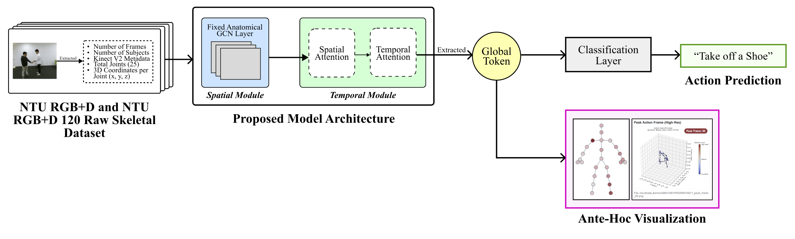
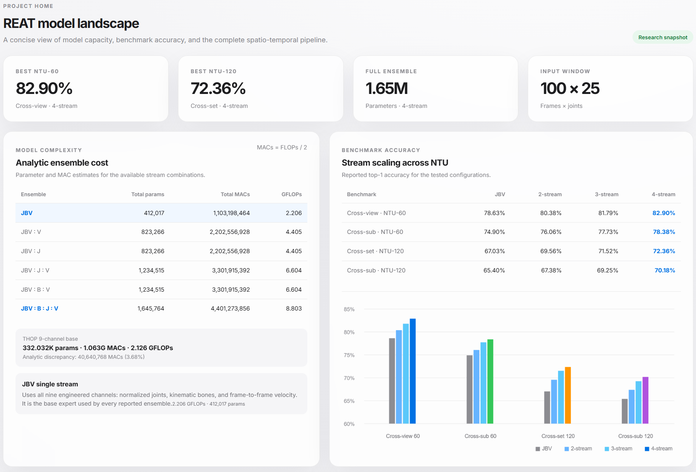
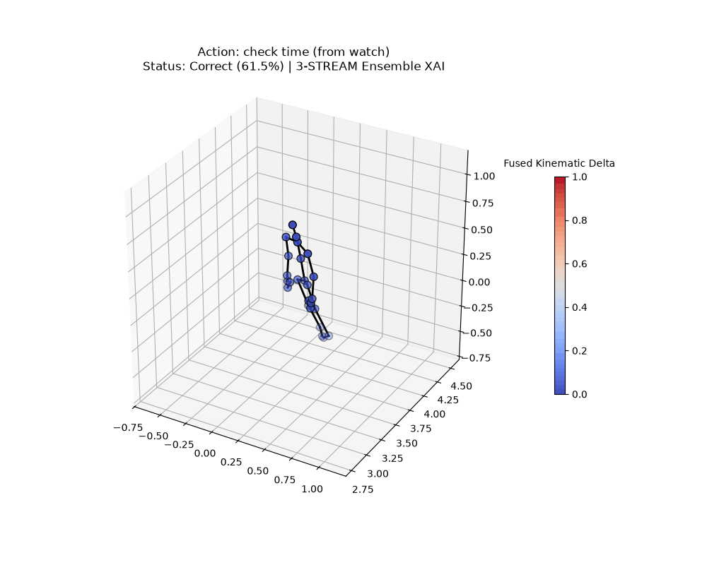
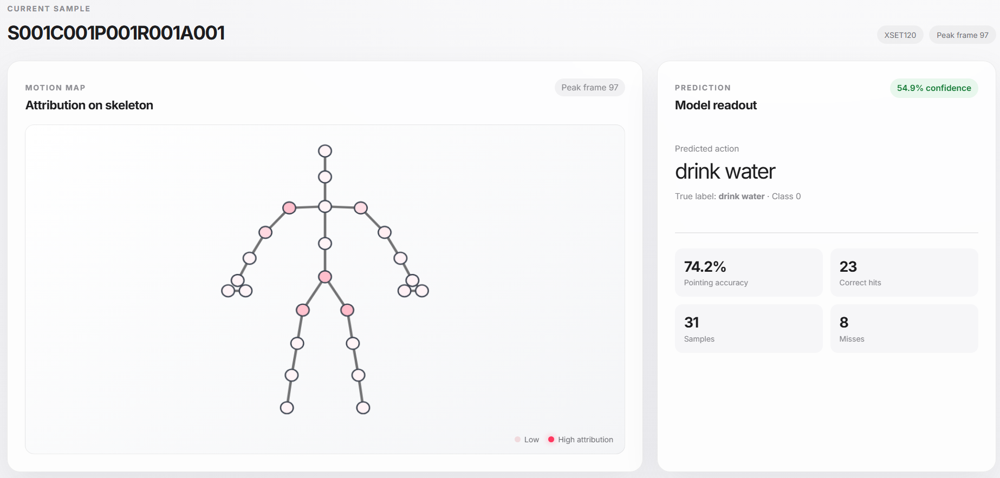
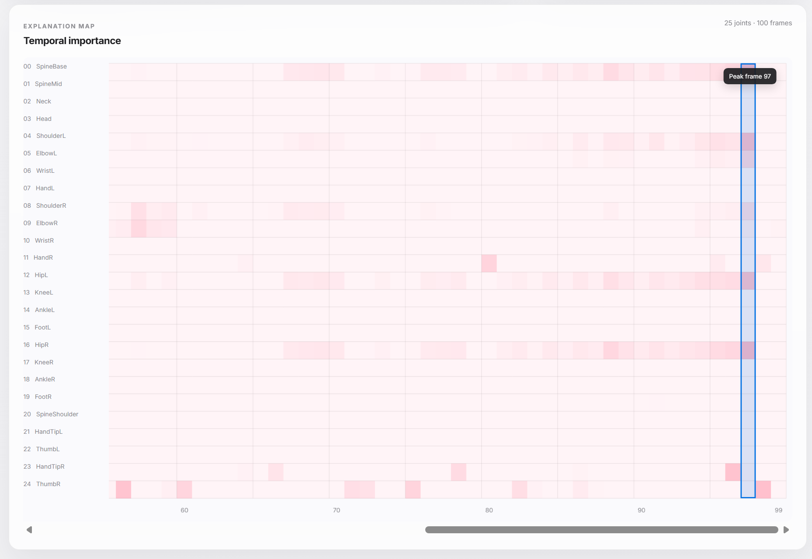
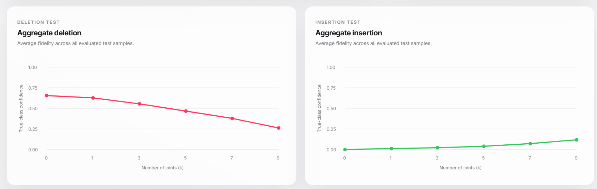
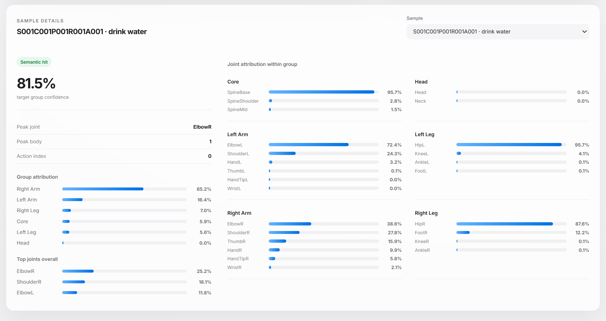

# REAT: Resource-Efficient Ante Hoc Architecture for 3D Skeleton-Based Human Action Recognition Preview

> A lightweight, explainable deep-learning pipeline for recognizing human actions from 3D skeleton sequences while exposing the spatial and temporal evidence used by the model.

## Overview

REAT (**Resource-Efficient Ante Hoc Architecture for 3D Skeleton-Based Action Recognition**) is a research-oriented software system for 3D skeleton-based human action recognition (HAR). It is evaluated on the NTU RGB+D 60 and NTU RGB+D 120 benchmarks and is designed as a transparent, resource-conscious alternative to heavyweight black-box video models.

The implementation combines graph-based spatial reasoning, locality-aware temporal attention, configurable motion representations, late-fusion ensembles, and built-in explainability validation in one reproducible pipeline.

### Key Features

- **Spatial skeleton reasoning:** A normalized 25-joint NTU RGB+D graph convolutional layer models anatomical relationships between joints.
- **Masked spatial-temporal attention:** A Transformer-based temporal brain uses anatomically constrained spatial attention, a learnable global node, body masking, and a sliding temporal window.
- **Multi-stream representations:** Train and evaluate joints, bones, velocity, or the combined 9-channel Joints-Bones-Velocity (JBV) representation.
- **Ante hoc XAI:** Extract attention-based explanations natively from the model, render 3D heatmaps/GIFs, and evaluate explanation fidelity and semantic alignment.
- **Visual evidence:** Communicate model predictions, attention maps, and explanation results through curated screenshots and rendered 3D visualizations.

## System Architecture

### Runtime Flow

1. Skeleton sequences are split and converted into binary tensors for repeatable training and evaluation.
2. Each sample is padded or truncated to 100 frames and represented with up to two bodies.
3. Coordinates are root-centered and normalized by spine height to reduce sensitivity to room position and subject scale.
4. Joints, bone vectors, and frame-to-frame velocity are derived from the normalized skeleton.
5. A Spatial GCN Module performs message passing over the 25-joint human skeleton graph.
6. The Temporal Module appends a global node, applies masked spatial attention, then models body-aware temporal context with a local sliding window.
7. Stream classifiers produce class probabilities; selected experts can be combined through late probability fusion.
8. Attention weights are converted into explanations and assessed using deletion-based fidelity and semantic body-region alignment.

## Tech Stack

### Machine Learning and Data

- **Python 3.11**
- **PyTorch** for model definition, training, inference, and attention extraction
- **NumPy** for tensor and explanation processing
- **Pandas** for experiment and result handling
- **Matplotlib / Pillow** for 3D explanation rendering and GIF generation
- **THOP** for analytical FLOPs/MACs profiling
- **Weights & Biases** for experiment tracking
- **NTU RGB+D 60 and 120** skeleton action-recognition benchmarks

### Model Components

- **Spatial GCN:** Anatomical graph message passing over 25 joints
- **Temporal Brain:** Masked multi-head spatial/temporal attention with global video aggregation
- **Configurable input pipelines:** `joints`, `bones`, `velocity`, and `jbv`
- **Late-fusion ensemble:** Weighted probability fusion across independently trained experts
- **XAI validation:** Fidelity testing, semantic body-group mapping, heatmaps, and 3D visualizations

### Execution Environment

- **CUDA-enabled PyTorch** for accelerated training and evaluation where available
- **Docker Compose** for reproducible GPU-oriented development and experimentation
- **Weights & Biases** for experiment tracking and run metadata

## Demo and Screenshots

> This portfolio artifact is intentionally limited to this README and selected visual assets, since the current project is still in progress.

### System Results

*The results of the different models produced in this project.*

### Explainability Visualization

*3D skeleton visualization showing the specific frame and joints receiving the strongest model attention.*

## Engineering Challenges and Insights

### Making Skeleton Attention Efficient and Interpretable

The temporal module must model long skeleton sequences without creating an unnecessarily expensive fully connected attention pattern. REAT addresses this with a sliding temporal attention window for physical tokens, while retaining a global video token that can aggregate sequence-level context. This makes the locality assumption explicit in code and produces attention weights that can be inspected as part of the model's forward computation.

### Supporting Multiple Representations Without Duplicating the Model

Joints, bones, velocity, and JBV inputs share the same GCN and Transformer design but differ in their channel selection. The pipeline configuration isolates input slicing and checkpoint naming from the training and evaluation loops, allowing controlled ablations and reproducible expert training without maintaining separate model implementations.

### Handling Variable People and Sequence Lengths

Real skeleton samples may contain fewer than two tracked people and may vary in duration. The loader standardizes sequences to 100 frames, retains a body mask for empty-person slots, and passes that mask into temporal attention. This prevents padded bodies from becoming accidental evidence during representation learning.

### Validating Explanations Rather Than Only Visualizing Them

The XAI workflow does not stop at rendering attractive heatmaps. Fidelity testing measures the confidence change after removing highly ranked joints, while semantic validation compares highlighted joints with meaningful body regions. These checks provide a measurable basis for assessing whether the explanation reflects the model's decision process.

### Performance and Reproducibility Placeholders

Complete the values below from the final benchmark and profiling runs:

| Measure | Result |
|---|---:|
| NTU RGB+D 60 accuracy | `82.90%` |
| NTU RGB+D 120 accuracy | `72.36%` |
| Best ensemble configuration | `4-stream (JBV + Joints + Bones + Velocity)` |
| Parameter count | `1.6M` |
| Computational cost | `8.803 GLOPs` |

## Project Scope and Access

This repository is a **recruiter-facing project brief** containing the README and selected screenshots or visualizations. The complete implementation, training scripts, datasets, model checkpoints, and experiment infrastructure are maintained in a separate private repository and are not included in this public-facing artifact.

The technical workflow described above reflects the implemented system. Source-code access can be provided selectively for academic review, technical discussion, or an interview process where appropriate.

## Reproducibility and Evaluation

- Training scripts record configuration and metrics with Weights & Biases.
- Checkpoints are separated by dataset, run identifier, and input pipeline.
- Fixed sequence length, body masking, feature construction, and fusion weights are defined in code rather than left implicit in notebooks.
- The reported values below should be populated from the final controlled benchmark and profiling runs.
- The NTU RGB+D dataset, trained weights, credentials, and private source code are intentionally excluded from this artifact.

## Publication and Citation Notice

*Research Pending...*

## License

The licensing status is currently **research-pending**. This portfolio artifact does not redistribute the private implementation, datasets, trained weights, or third-party benchmark data.

## Acknowledgements

- NTU RGB+D dataset authors and maintainers
- PyTorch, NumPy, Matplotlib, and the open-source ecosystem used by this project

